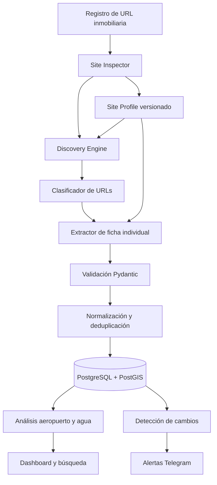

# Patagonia Land Intelligence

**Especificación técnica — V1.0 — Noviembre 2026**

## 1. Objetivo y alcance

Construir un sistema automatizado para descubrir, extraer, normalizar, analizar y monitorear publicaciones de **lotes, terrenos, chacras y campos** de inmobiliarias locales de Patagonia, exclusivamente en zonas accesibles en hasta **150 minutos en auto** desde estos tres aeropuertos:

| Código IATA | Aeropuerto | Región |
|---|---|---|
| BRC | San Carlos de Bariloche | Bariloche y alrededores |
| CPC | Aviador Carlos Campos (Chapelco) | San Martín y Junín de los Andes |
| EQS | Esquel | Esquel y Trevelin |

No incluir otros aeropuertos en la V1. El radio temporal será configurable y no se confundirá con distancia en línea recta.

**Prioridad:** inmobiliarias locales, cada una con sitios potencialmente distintos. El usuario debe poder registrar una URL y el sistema debe intentar encontrar automáticamente todos los anuncios relevantes, entrar en cada ficha y extraer sus datos. Portales grandes serán fuentes opcionales posteriores.

## 2. Principios de diseño

1. Alta de fuentes mediante URL, sin desarrollar un scraper nuevo por defecto.
2. Separar **descubrimiento de fichas**, **extracción**, **normalización**, **deduplicación** y **análisis geográfico**.
3. Conservar URL, evidencia, datos originales y snapshots históricos.
4. Priorizar parsers determinísticos y utilizar LLM como fallback.
5. No inventar campos; representar desconocidos como `null` y registrar confianza/procedencia.
6. Reutilizar perfiles de sitio y detectar cuando dejan de funcionar.
7. Recopilar independientemente de los filtros del usuario.
8. Ejecutar localmente con Docker Compose y migrar sin rediseño a un VPS.
9. Respetar robots.txt, condiciones de uso y límites de tráfico; no evadir controles de acceso.

## 3. Arquitectura



### Stack

- Python 3.12+, HTTPX, BeautifulSoup/selectolax y Playwright.
- Pydantic para esquemas; SQLAlchemy y Alembic para persistencia.
- PostgreSQL + PostGIS; Shapely/GeoPandas para geometrías.
- FastAPI para backend; Streamlit para dashboard inicial.
- OpenRouteService o GraphHopper para isócronas y tiempos de viaje.
- Scheduler mediante APScheduler o jobs independientes.
- LLM con salida estructurada JSON para casos ambiguos.
- pytest, Docker Compose, Telegram Bot API.

## 4. Incorporación inteligente de inmobiliarias

### 4.1 Registro de fuentes

Cada fuente admite dominio principal, páginas de categorías o resultados específicos:

```yaml
sources:
  - id: inmobiliaria_bariloche_01
    name: "Inmobiliaria Bariloche 01"
    base_url: "https://example.com"
    start_urls:
      - "https://example.com/propiedades"
    enabled: true
    discovery_mode: auto
    extraction_mode: auto
    crawl_interval_hours: 24
    max_pages_per_run: 200
    max_depth: 5
    region: bariloche

  - id: inmobiliaria_chapelco_01
    name: "Inmobiliaria Chapelco 01"
    base_url: "https://example.org"
    enabled: true
    discovery_mode: auto
    extraction_mode: auto
    crawl_interval_hours: 24
    region: chapelco

  - id: inmobiliaria_esquel_01
    name: "Inmobiliaria Esquel 01"
    base_url: "https://example.net"
    enabled: true
    discovery_mode: auto
    extraction_mode: auto
    crawl_interval_hours: 24
    region: esquel
```

Las URLs anteriores son ejemplos, no fuentes reales verificadas.

### 4.2 Site Inspector

Al registrar una URL, inspeccionar automáticamente:

- `robots.txt`, sitemaps e índices de sitemap.
- HTML estático frente a renderizado JavaScript.
- JSON-LD, microdatos y metadatos de propiedades.
- Patrones de URLs de categorías, listados y fichas.
- Paginación numerada, `next`, `load more` y scroll infinito.
- Peticiones JSON públicas usadas por la web, cuando su acceso esté permitido.
- Selectores y componentes repetidos en las fichas.
- Necesidad de Playwright y errores de acceso.

Preferencia: sitemap/datos estructurados → HTTP/HTML → endpoints públicos permitidos → Playwright → interpretación semántica con LLM.

Guardar un `SiteProfile` versionado:

```json
{
  "source_id": "inmobiliaria_bariloche_01",
  "rendering": "static",
  "discovery_strategy": "pagination",
  "listing_patterns": ["/propiedad/", "/terreno/", "/campo/"],
  "pagination": {"type": "query_parameter", "parameter": "page"},
  "detail_strategy": "html_with_llm_fallback",
  "confidence": 0.92,
  "profile_version": 1
}
```

Los perfiles generados automáticamente no deben sobrescribir overrides manuales.

### 4.3 Discovery Engine

Objetivo: identificar **todas las URLs de fichas individuales**, no solamente las tarjetas de la primera página.

Debe soportar sitemaps, menús, categorías, paginación, filtros, botones de carga y scroll infinito, con límites de profundidad y páginas por ejecución.

Clasificar cada URL candidata en:

- `PROPERTY_DETAIL`
- `PROPERTY_LIST`
- `PAGINATION`
- `CATEGORY`
- `OTHER`
- `UNKNOWN`

Utilizar URL, título, contenido, estructura DOM, enlaces, datos estructurados y fallback semántico. Una ruta `/propiedad/123` es una señal, no una prueba definitiva.

Pseudocódigo:

```python
async def discover_properties(source):
    profile = await get_or_create_site_profile(source)
    candidates = set(await discover_from_sitemaps(source))
    candidates.update(await crawl_site(source, profile))
    details = []
    for url in candidates:
        result = await classify_url(url, profile)
        if result.page_type == "PROPERTY_DETAIL":
            details.append(url)
    return canonicalize_and_deduplicate_urls(details)
```

Mantener una cola de URLs con `discovered_at`, `last_fetched_at`, `status`, `depth`, `parent_url` y `content_hash`. Evitar loops y URLs infinitas por parámetros de búsqueda.

### 4.4 Extracción de cada ficha

Cada ficha se procesa individualmente y debe extraer, cuando estén disponibles:

- **Identidad:** `source_id`, `external_listing_id`, URL original, URL canónica, título, estado.
- **Comercial:** precio, moneda, expensas si corresponden, fecha publicada y última actualización.
- **Superficie:** m², hectáreas, superficie construida, unidades originales.
- **Ubicación:** provincia, localidad, dirección o referencia, latitud, longitud, precisión geográfica.
- **Características:** tipo de inmueble, accesos, servicios, electricidad, gas, agua, mejoras, construcciones, topografía, vegetación.
- **Agua:** costa propia declarada, acceso al agua, lago, río, arroyo, vertiente, vista, distancia mencionada.
- **Contenido:** descripción completa, fotos, planos y documentos públicos.
- **Proveniencia:** fragmento de evidencia, método de extracción y confianza por campo.

Flujo de extracción: JSON-LD/metadatos → selectores de perfil → parser HTML genérico → LLM para campos faltantes/ambiguos → Pydantic → persistencia.

Ejemplo de salida:

```json
{
  "property_type": "campo",
  "title": "Campo con costa de río en Trevelin",
  "price": 380000,
  "currency": "USD",
  "area_m2": 420000,
  "location": {
    "province": "Chubut",
    "locality": "Trevelin",
    "latitude": null,
    "longitude": null,
    "precision": "locality"
  },
  "water": {
    "waterfront_claimed": true,
    "water_type": "river",
    "water_name": null,
    "evidence": "Campo con costa de río",
    "confidence": 0.94
  },
  "confidence": 0.89
}
```

**Reglas:** nunca inventar datos; `null` para ausentes; conservar valor original y normalizado; convertir ha a m²; distinguir costa, acceso, vista y cercanía; no asumir coordenadas exactas si solo se menciona una localidad; no afirmar disponibilidad por el mero hecho de que una URL exista.

### 4.5 Adaptadores reutilizables

Jerarquía de extracción:

`manual override → site-specific adapter → structured data → generic HTML extractor → LLM fallback`.

Ejemplo:

```yaml
site_profile:
  source_id: inmobiliaria_bariloche_01
  selectors:
    property_cards: ".property-card"
    property_links: "a.property-link"
    title: "h1.property-title"
    price: ".property-price"
    description: ".property-description"
  pagination:
    next_selector: "a.next"
  extraction:
    use_json_ld: true
    use_llm_fallback: true
```

El LLM puede sugerir selectores y estrategias, pero estos deben validarse con fichas de muestra antes de activar su uso automático.

### 4.6 Control de calidad

Por ejecución registrar: páginas visitadas, URLs candidatas, fichas descubiertas, fichas procesadas, propiedades válidas, errores, porcentaje con precio/superficie, duración, versión de perfil y fecha de última ejecución exitosa.

Si una fuente habitualmente muestra 120 fichas y una ejecución encuentra 4, generar alerta de posible rotura. **No marcar automáticamente 116 anuncios como retirados**.

## 5. Modelo de datos

Usar tablas:

| Tabla | Función |
|---|---|
| `sources` | Inmobiliarias y configuración |
| `site_profiles` | Estrategias y selectores versionados |
| `crawl_runs` | Ejecuciones, métricas y errores |
| `crawled_pages` | URLs, hashes, respuestas y estado |
| `properties` | Inmuebles físicos deduplicados |
| `listings` | Anuncios por fuente |
| `listing_snapshots` | Historial de contenido relevante |
| `listing_changes` | Cambios detectados |
| `airports` | Solo BRC, CPC y EQS |
| `airport_isochrones` | Polígonos por minutos de viaje |
| `water_features` | Ríos, lagos, arroyos, costa |
| `property_geo_analysis` | Distancias, tiempos, confianza |
| `alerts` | Notificaciones y estado de envío |

Identidad preferida: `(source_id, external_listing_id)`; fallback `(source_id, canonical_url)`. Conservar `first_seen_at`, `last_seen_at`, `last_checked_at`, `status`.

Crear snapshots cuando cambie contenido relevante; conservar HTML/JSON original comprimido y `content_hash`. Una revisión sin cambios actualiza `last_checked_at` sin duplicar snapshots.

## 6. Deduplicación entre inmobiliarias

El mismo campo puede aparecer en varias fuentes con diferentes precios y descripciones. Agrupar mediante candidatos por zona/superficie y puntuación por ubicación, superficie, fotos, texto y precio.

No fusionar automáticamente casos ambiguos: dejar una cola de revisión manual. Mantener siempre las fichas originales, sus fuentes y sus historiales. La propiedad física es una entidad distinta del anuncio.

## 7. Análisis geográfico

### 7.1 Aeropuertos habilitados

```yaml
airports:
  - code: BRC
    name: "San Carlos de Bariloche"
    enabled: true
  - code: CPC
    name: "Chapelco - Aviador Carlos Campos"
    enabled: true
  - code: EQS
    name: "Esquel"
    enabled: true
```

**No incluir otros aeropuertos** en el catálogo inicial ni en los filtros de V1.

### 7.2 Isócronas y tiempos

```yaml
geography:
  max_drive_minutes: 150
  routing_provider: openrouteservice
  airports: [BRC, CPC, EQS]
```

Calcular isócronas por automóvil y almacenarlas en PostGIS. Para propiedades con coordenadas fiables, calcular duración punto a punto. Las coordenadas de localidad o referencias aproximadas deben mostrar incertidumbre; no atribuirles tiempos exactos.

### 7.3 Agua

Cruzar análisis textual de la ficha con hidrografía de OpenStreetMap y datasets oficiales cuando estén disponibles. Guardar cuerpo de agua más cercano, tipo, nombre y distancia estimada.

Clasificación:

- `waterfront_confirmed`: límite parcelario fiable confirma costa.
- `waterfront_claimed`: la publicación declara costa.
- `waterfront_possible`: evidencia indirecta.
- `water_nearby`: agua próxima, sin afirmar costa.
- `water_view_only`: solo vista.
- `unknown`: información insuficiente.

Un punto cercano al agua **no prueba** que la parcela tenga costa. Para confirmarlo se requieren geometrías catastrales fiables o evidencia documental.

## 8. Monitoreo y alertas

Tipos de eventos:

```python
class ChangeType(str, Enum):
    NEW_LISTING = "new_listing"
    PRICE_DECREASED = "price_decreased"
    PRICE_INCREASED = "price_increased"
    AREA_CHANGED = "area_changed"
    DESCRIPTION_CHANGED = "description_changed"
    REMOVED = "removed"
    RELISTED = "relisted"
```

No marcar un anuncio como eliminado tras una sola ausencia. Exigir verificaciones repetidas y distinguir fallas de scraping de bajas reales.

Alertas Telegram configurables por aeropuerto, precio, superficie, agua, nueva publicación y porcentaje de variación. Incluir URL de origen y enlace al mapa cuando existan coordenadas.

## 9. Filtros de búsqueda

Separar recopilación de filtros; cambiar filtros no debe exigir scrapear nuevamente.

```yaml
search:
  property_types: [terreno, lote, chacra, campo]
  max_price_usd: 500000
  min_area_m2: 5000
  airports: [BRC, CPC, EQS]
  max_drive_minutes: 150
  max_water_distance_m: 1000
  waterfront_only: false
  include_unknown_location: true
```

## 10. Dashboard

**Fuentes:** alta por URL, estado, últimas ejecuciones, errores, páginas encontradas, overrides, ejecutar inspección/crawl.

**Propiedades:** tabla, filtros, precio por hectárea, descripción, fotos, URL, evidencias, confianza e historial de precio.

**Mapa:** propiedades, aeropuertos BRC/CPC/EQS, isócronas y cuerpos de agua; distinguir coordenadas precisas de aproximadas.

**Monitoreo:** nuevos anuncios, cambios, posibles bajas, fallas por fuente y revisiones pendientes.

## 11. API

```http
POST /sources
GET  /sources
GET  /sources/{id}
POST /sources/{id}/inspect
POST /sources/{id}/crawl
GET  /sources/{id}/runs
GET  /properties
GET  /properties/{id}
GET  /properties/{id}/history
GET  /listings/{id}
GET  /changes
GET  /airports
GET  /health
```

Procesos largos deben ser jobs en background con identificador, estado, progreso y resultado consultables.

## 12. Seguridad y scraping responsable

- Respetar `robots.txt`, términos aplicables, límites de tráfico y señales de bloqueo.
- Rate limiting por dominio, backoff, retries y cache HTTP.
- No evadir CAPTCHA, login, paywalls ni restricciones técnicas.
- No recopilar datos personales innecesarios.
- Bloquear SSRF: IPs privadas, localhost, metadata cloud y redirecciones a destinos prohibidos.
- Aislar Playwright y limitar recursos, descargas y ejecución.
- Secretos solo en variables de entorno; autenticación y HTTPS en producción.
- Logs estructurados y backups periódicos.

## 13. Infraestructura

Servicios Docker Compose:

```text
postgres
api
scraper-worker
scheduler
dashboard
```

Inicio local:

```bash
docker compose up -d --build
```

Usar volúmenes persistentes, migraciones, health checks y jobs idempotentes. Para VPS inicial, orientar dimensionamiento a 2–4 vCPU, 4–8 GB RAM y 80 GB SSD, ajustando según concurrencia de Playwright y volumen de imágenes/HTML.

## 14. Estructura del repositorio

```text
patagonia-land/
├── README.md
├── docker-compose.yml
├── Dockerfile
├── .env.example
├── pyproject.toml
├── config/
│   ├── airports.yaml
│   ├── search.yaml
│   └── sources.yaml
├── src/
│   ├── api/
│   ├── db/
│   ├── models/
│   ├── crawling/
│   │   ├── inspector.py
│   │   ├── discovery.py
│   │   ├── classifier.py
│   │   ├── fetcher.py
│   │   └── pagination.py
│   ├── extraction/
│   │   ├── structured_data.py
│   │   ├── html_extractor.py
│   │   ├── llm_extractor.py
│   │   ├── schemas.py
│   │   └── validation.py
│   ├── adapters/
│   │   ├── base.py
│   │   └── generic.py
│   ├── intelligence/
│   │   ├── normalization.py
│   │   ├── deduplication.py
│   │   └── water_classifier.py
│   ├── geo/
│   │   ├── airports.py
│   │   ├── routing.py
│   │   └── hydrography.py
│   ├── monitoring/
│   │   ├── changes.py
│   │   └── notifications.py
│   └── scheduler/
├── dashboard/
├── migrations/
├── tests/
│   ├── fixtures/
│   ├── test_discovery.py
│   ├── test_extraction.py
│   ├── test_deduplication.py
│   └── test_monitoring.py
└── docs/
    ├── architecture.md
    └── adding_sources.md
```

## 15. Plan de implementación

1. **Infraestructura:** Docker, PostgreSQL/PostGIS, modelos, migraciones, configuración y API.
2. **Motor de inmobiliarias:** Site Inspector, Discovery Engine, paginación, clasificación y extracción inteligente. Validar con tres sitios de estructuras distintas.
3. **Histórico:** snapshots, detección de cambios, deduplicación y Telegram.
4. **Geografía:** BRC/CPC/EQS, tiempos de manejo de hasta 150 minutos (matriz ORS; isócronas de 30/60 min solo para el mapa), hidrografía y clasificación de costa.
5. **Dashboard y servidor:** alta de fuentes, búsqueda, mapa, monitoreo y despliegue VPS.

## 16. Criterios de aceptación V1

- Registrar una inmobiliaria mediante URL sin modificar código.
- Descubrir fichas y recorrer paginación de al menos tres sitios de estructuras distintas.
- Extraer título, URL, precio, moneda, superficie, ubicación y descripción cuando existan.
- Validar y marcar ausencias sin inventar datos.
- Guardar historial y detectar cambios de precio.
- Revisar resultados y errores en dashboard.
- Filtrar exclusivamente por BRC, CPC y EQS y hasta 150 minutos de conducción.
- Identificar evidencia textual de agua y proximidad geográfica sin confundirla con costa confirmada.
- Ejecutar íntegramente mediante Docker Compose.

Crear un dataset de evaluación de al menos 100 fichas etiquetadas manualmente de las tres inmobiliarias piloto. Objetivos iniciales: 95% de recall de descubrimiento y 95% de exactitud en precio/superficie cuando estén explícitamente presentes. Medir los resultados, no presumirlos.

## 17. Primer entregable práctico

El primer vertical slice debe funcionar así:

```text
Agregar URL de inmobiliaria
  → inspeccionar sitio
  → detectar categorías/listados/paginación
  → descubrir fichas individuales
  → extraer y validar cada ficha
  → persistir datos, evidencia y snapshots
  → visualizar propiedades
  → programar revisión y detectar cambios
```

**Prioridad absoluta:** calidad del descubrimiento y de la extracción de fichas de inmobiliarias locales. La inteligencia geográfica se añade sobre datos confiables y trazables.
